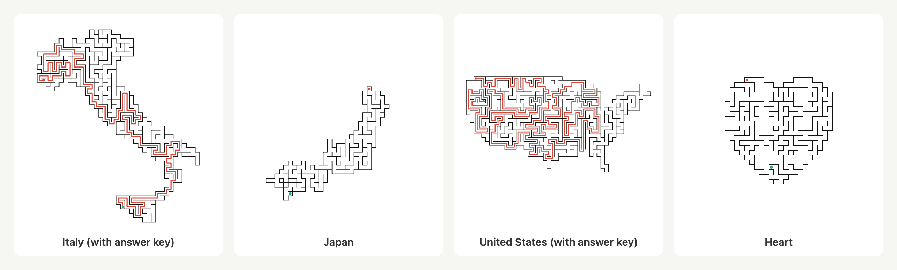

# MazeDIY MCP: maze generator and country maze dataset

Generate printable mazes in any shape, including the outline of 234 countries, straight from Claude, Cursor or any MCP client. Every maze has exactly one solution and comes with an answer key. The server can also search 2,000+ free printable mazes from [MazeDIY](https://mazediy.com).

The repository also ships the data as an open dataset: 2,000 shape mazes (animals, dinosaurs, vehicles, food and more) that match MazeDIY's printable pages, 234 country-shaped mazes and 50 US state mazes, each with its grid, solution path and image links. Browse the [country maze gallery](docs/COUNTRIES.md).



## Tools

| Tool | What it does |
|---|---|
| `generate_maze` | Makes a maze as SVG (for printing), ASCII (for chat) or JSON. Shapes: rectangle, circle, heart, star, diamond, triangle, hexagon, or any country by name or ISO code. Options: size, seed, answer key. |
| `list_countries` | Lists the 234 country outlines, filterable by name or continent. |
| `find_printable_mazes` | Searches ready-made printable mazes on MazeDIY (animals, dinosaurs, holidays, vehicles, US states and more), each with a print page and answer key. |

Example prompts:

- "Make a 25x25 heart-shaped maze for my daughter, with an answer key."
- "Generate a maze in the shape of Japan for a geography lesson."
- "Find a printable dinosaur maze."

## Install

**Remote server, nothing to install**: add `https://mazediy.com/mcp` as a remote MCP server (Streamable HTTP, no sign-in).

```bash
claude mcp add --transport http mazediy https://mazediy.com/mcp
```

**Local server** (Node.js 18 or later):

**Claude Code**

```bash
claude mcp add mazediy -- npx -y mazediy-mcp
```

**Claude Desktop, Cursor, Windsurf and other clients**: add to the client's MCP config:

```json
{
  "mcpServers": {
    "mazediy": {
      "command": "npx",
      "args": ["-y", "mazediy-mcp"]
    }
  }
}
```

**VS Code**

```bash
code --add-mcp '{"name":"mazediy","command":"npx","args":["-y","mazediy-mcp"]}'
```

## Dataset

All files are in [`data/`](data). Format details are in [`data/README.md`](data/README.md).

| File | Contents |
|---|---|
| `shape-mazes.jsonl` | 2,000 shape mazes across 37 themes, identical to the mazes on MazeDIY's printable pages, with page, image and answer-key URLs. |
| `country-shapes.json` | 234 country outlines rasterized to grids (longer side 96 cells), from Natural Earth. |
| `country-mazes.jsonl` | One perfect maze per country, with start, end and solution. Reproducible: `npm run dataset`. |
| `us-state-mazes.jsonl` | 50 mazes from MazeDIY's printable collection (49 US states without Hawaii, plus Washington, D.C.), with solutions. |
| `printable-mazes.json` | Index of 2,145 printable mazes on mazediy.com with page, image and answer-key URLs. |

Uses: visual reasoning benchmarks (can a model solve the maze in the image?), maze-solving and path-finding benchmarks, reinforcement learning environments, geography games, and teaching search algorithms such as BFS and A*.

## Want more than a plain maze?

[MazeDIY](https://mazediy.com) turns your own photo, a child's name or a hidden message into a printable maze, with print-ready PNG and PDF downloads:

- [Picture maze maker](https://mazediy.com/picture-maze): a maze in the shape of your photo
- [Name maze generator](https://mazediy.com/name-maze)
- [Hidden message maze](https://mazediy.com/hidden-message-maze)
- [Free printable mazes](https://mazediy.com/printable-mazes)

## Development

```bash
npm install
npm test            # generator, every country, and the MCP server over stdio
npm run dataset     # rebuild data/country-mazes.jsonl
python3 scripts/build-country-shapes.py ne_50m_admin_0_countries.geojson data/country-shapes.json
```

The outlines come from the Natural Earth [1:50m Admin 0 countries](https://www.naturalearthdata.com/downloads/50m-cultural-vectors/50m-admin-0-countries-2/) file. Small distant territories are left out, and islands are joined to the mainland by one-cell causeways so every maze is a single solvable region. Country names follow Natural Earth and are not a position on any border dispute.

## License

Code: [MIT](LICENSE). Data in `data/`: [CC BY 4.0](data/LICENSE). Please credit "MazeDIY (https://mazediy.com)" when you use the dataset. Natural Earth outlines are public domain.
