# Country maze gallery

One maze for each of the 234 country outlines, generated with seed 2026 at size 28. Make your own with `generate_maze` (any size, any seed, with answer key).

Countries with a link have a free printable maze page on [MazeDIY](https://mazediy.com/countries-maze).

## Africa

<a href="https://mazediy.com/countries-maze/algeria" title="Algeria printable maze">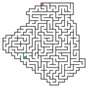</a>
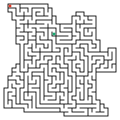
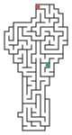
<a href="https://mazediy.com/countries-maze/botswana" title="Botswana printable maze">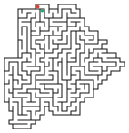</a>
<a href="https://mazediy.com/countries-maze/burkina-faso" title="Burkina Faso printable maze">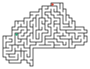</a>
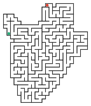
<a href="https://mazediy.com/countries-maze/cameroon" title="Cameroon printable maze">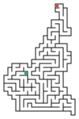</a>
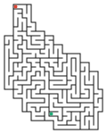
<a href="https://mazediy.com/countries-maze/central-african-republic" title="Central African Republic printable maze">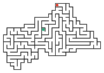</a>
<a href="https://mazediy.com/countries-maze/chad" title="Chad printable maze">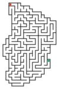</a>
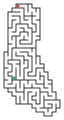
<a href="https://mazediy.com/countries-maze/dr-congo" title="Democratic Republic of the Congo printable maze">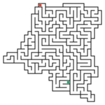</a>
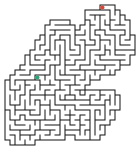
<a href="https://mazediy.com/countries-maze/egypt" title="Egypt printable maze">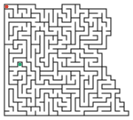</a>
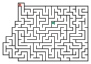
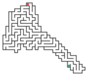
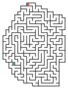
<a href="https://mazediy.com/countries-maze/ethiopia" title="Ethiopia printable maze">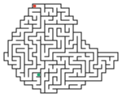</a>
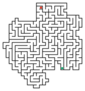
<a href="https://mazediy.com/countries-maze/ghana" title="Ghana printable maze">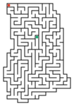</a>
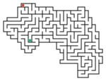
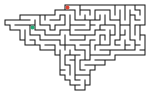
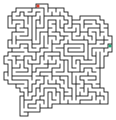
<a href="https://mazediy.com/countries-maze/kenya" title="Kenya printable maze">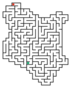</a>
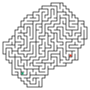
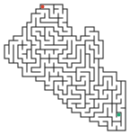
<a href="https://mazediy.com/countries-maze/libya" title="Libya printable maze">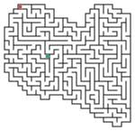</a>
<a href="https://mazediy.com/countries-maze/madagascar" title="Madagascar printable maze">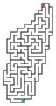</a>
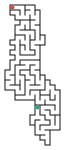
<a href="https://mazediy.com/countries-maze/mali" title="Mali printable maze">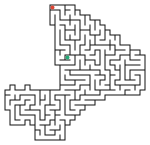</a>
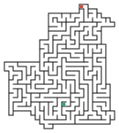
<a href="https://mazediy.com/countries-maze/morocco" title="Morocco printable maze">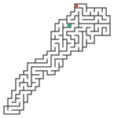</a>
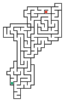
<a href="https://mazediy.com/countries-maze/namibia" title="Namibia printable maze">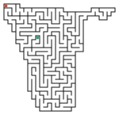</a>
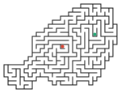
<a href="https://mazediy.com/countries-maze/nigeria" title="Nigeria printable maze">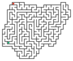</a>
<a href="https://mazediy.com/countries-maze/congo" title="Republic of the Congo printable maze">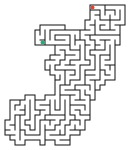</a>
<a href="https://mazediy.com/countries-maze/rwanda" title="Rwanda printable maze">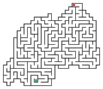</a>
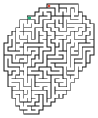
<a href="https://mazediy.com/countries-maze/senegal" title="Senegal printable maze">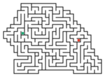</a>
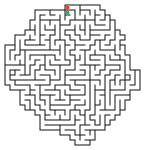
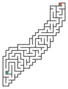
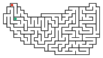
<a href="https://mazediy.com/countries-maze/south-africa" title="South Africa printable maze">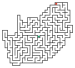</a>
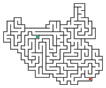
<a href="https://mazediy.com/countries-maze/sudan" title="Sudan printable maze">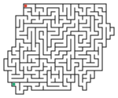</a>
<a href="https://mazediy.com/countries-maze/tanzania" title="Tanzania printable maze">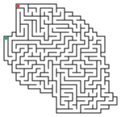</a>
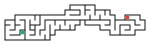
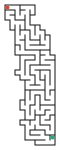
<a href="https://mazediy.com/countries-maze/tunisia" title="Tunisia printable maze">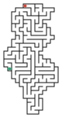</a>

## Antarctica

## Asia

## Europe

## North America

## Oceania

## Seven seas (open ocean)

## South America

